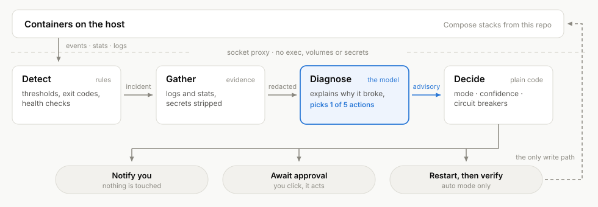

# Container Doctor

An AI triage agent for the Docker containers on one Linux host. Deterministic
rules decide whether something is wrong; a model explains why and proposes at
most one fixed action; plain code decides whether anything happens - and, by
default, nothing does until you approve it. Everything it sees, thinks and
does is on a web dashboard.

<p align="center">
  <picture>
    <source media="(prefers-color-scheme: dark)" srcset="docs/how-it-works-dark.svg">
    
  </picture>
</p>

It reaches Docker only through a socket proxy that lets it restart a container
but never create one, and it needs no mount of your data.

## Quick start

```bash
curl -O https://raw.githubusercontent.com/sebastianbuechler/container-doctor/main/compose.example.yaml
mkdir -p data && sudo chown 1000:1000 data
cat > .env <<'ENV'
ANTHROPIC_API_KEY=sk-ant-...
DOCTOR_WEB_PASSWORD=something-long
ENV
docker compose -f compose.example.yaml up -d
```

Open `http://<host>:8080`. It starts in `observe` mode: it detects and
diagnoses, and changes nothing.

- **Configuration:** every variable is in [`.env.example`](.env.example). Only
  secrets and sign-in need setting there; the rest can be changed on the
  dashboard's Settings page.
- **Any OpenAI-compatible model** works instead of Anthropic, local ones
  included (`DOCTOR_LLM_PROVIDER=openai`, `DOCTOR_OPENAI_BASE_URL`).
- **Optional:** OIDC sign-in, ntfy notifications, SMART drive health (the
  `doctor-smart` service; remove it if you don't want it), and a Redeploy
  button through a GitHub Actions workflow
  ([`docs/redeploy-workflow.yml`](docs/redeploy-workflow.yml)).

## More

[`docs/guide.md`](docs/guide.md) covers everything in depth: what opens an
incident, the dashboard, settings, sign-in, models and their cost, and
security.

## Development

```bash
pip install -r requirements.txt
python -m unittest discover -s tests
```
