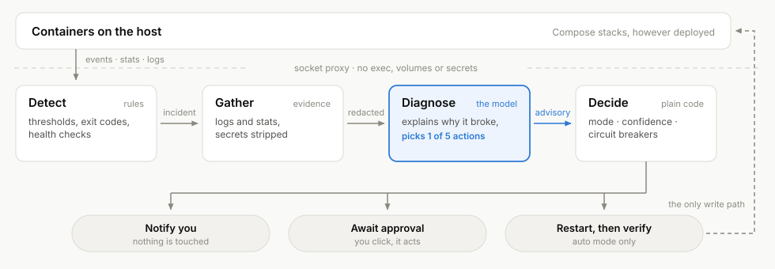

# Container Doctor

[](https://github.com/sebastianbuechler/container-doctor/actions/workflows/tests.yml)
[](https://github.com/sebastianbuechler/container-doctor/actions/workflows/image.yml)
[](https://github.com/sebastianbuechler/container-doctor/releases/latest)
[](LICENSE)

**[Documentation](https://sebastianbuechler.github.io/container-doctor/)** ·
[Quick start](https://sebastianbuechler.github.io/container-doctor/getting-started/quick-start/) ·
[Releases](https://github.com/sebastianbuechler/container-doctor/releases)

An AI triage agent for the Docker containers on one Linux host. Deterministic
rules decide whether something is wrong; a model explains why and proposes at
most one fixed action; plain code decides whether anything happens - and, by
default, nothing does until you approve it. Everything it sees, thinks and
does is on a web dashboard.

<p align="center">
  <picture>
    <source media="(prefers-color-scheme: dark)" srcset="docs/src/assets/how-it-works-dark.svg">
    
  </picture>
</p>

It reaches Docker only through a socket proxy that lets it restart a container
but never create one, and it needs no mount of your data.

## Security: read this first

- **Your logs go to a model.** Each diagnosis sends the incident's log tail
  and container metadata (name, image, state, labels, recent changes) to the
  LLM provider you configure - a third party, unless you run a local model.
  Secrets are redacted first, but redaction is pattern-based and best effort.
- **It can restart containers.** In `suggest` mode it does so when you
  approve; in `auto` mode on its own, within the allowed actions, confidence
  threshold and rate limits. Start in `observe` (the default), read its
  diagnoses for a while, and keep `stop_container` and `prune_images` out of
  `DOCTOR_AUTO_ACTIONS`.
- **The dashboard needs a sign-in.** Set `DOCTOR_WEB_PASSWORD` (long and
  random) or configure OIDC; with neither, it refuses every request. The
  password is HTTP Basic auth, so never expose the dashboard beyond your LAN
  without a reverse proxy with TLS in front of it.

More on the docs site's [Security](https://sebastianbuechler.github.io/container-doctor/guides/security/) page; to report
a vulnerability, see [SECURITY.md](SECURITY.md).

## Requirements

- A Linux host (amd64 or arm64) running Docker Engine. 25 or newer is
  recommended: older engines ignore the image's health-check
  `--start-interval`, so a fresh container reads *starting* for its first
  minute.
- Docker Compose v2 (`docker compose`), or a Docker manager that runs Compose
  files (Portainer, Dockge, Komodo, ...).
- An LLM API key - Anthropic by default, or any OpenAI-compatible endpoint,
  local ones included. Optional: without one it still detects incidents, it
  just cannot explain them.

## Quick start

```bash
curl -O https://raw.githubusercontent.com/sebastianbuechler/container-doctor/main/compose.example.yaml
mkdir -p data && sudo chown 1000:1000 data
cat > .env <<ENV
ANTHROPIC_API_KEY=sk-ant-...
DOCTOR_WEB_PASSWORD=$(openssl rand -base64 24)
ENV
docker compose -f compose.example.yaml up -d
```

Open `http://<host>:8080` and sign in as `doctor` with the password from
`.env`. It starts in `observe` mode: it detects and diagnoses, and changes
nothing.

- **Configuration:** every variable is in [`.env.example`](.env.example).
  Secrets, sign-in and the addresses a secret is sent to are set there; the
  rest can also be changed on the dashboard's Settings page.
- **Any OpenAI-compatible model** works instead of Anthropic, local ones
  included (`DOCTOR_LLM_PROVIDER=openai`, `DOCTOR_OPENAI_BASE_URL`). The
  default is `claude-opus-5-5`.
- **Optional:** OIDC sign-in, ntfy notifications (pick a long random topic on
  public ntfy.sh), SMART drive health (the `doctor-smart` sidecar, which has
  raw disk access and starts only with `docker compose --profile smart up -d`),
  and a Redeploy button through a GitHub Actions workflow
  ([`examples/redeploy-workflow.yml`](examples/redeploy-workflow.yml)).

## More

The [documentation](https://sebastianbuechler.github.io/container-doctor/)
covers everything in depth: what opens an incident, the dashboard, settings,
sign-in, models and their cost, security, and every environment variable.
Changes are listed in [CHANGELOG.md](CHANGELOG.md).

## Development

```bash
python -m venv .venv && . .venv/bin/activate
pip install -r requirements.txt -r requirements-dev.txt
python -m unittest discover -s tests
```

See [CONTRIBUTING.md](CONTRIBUTING.md). Every push to `main` runs the tests and
then publishes the image as `edge`. A release is cut by the **Release**
workflow (Actions → Release → Run workflow, with `X.Y.Z`): it runs the tests,
tags `main`, publishes `X.Y.Z`, `X.Y` and `latest`, then the GitHub release.

## License

[MIT](LICENSE)
